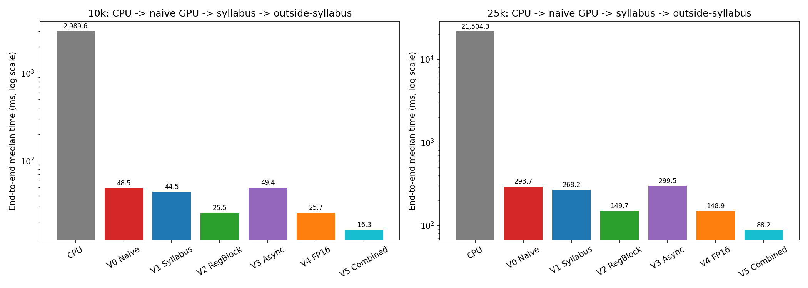
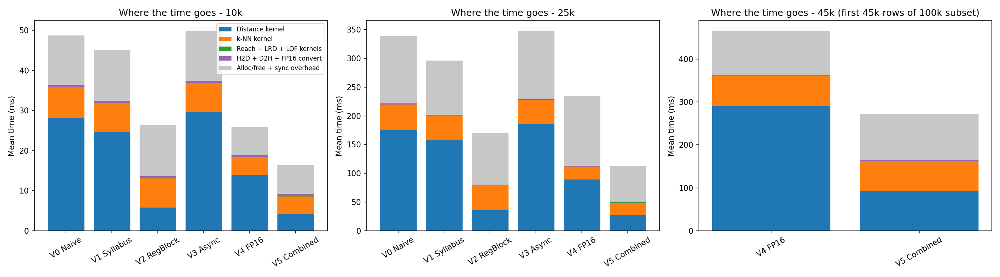
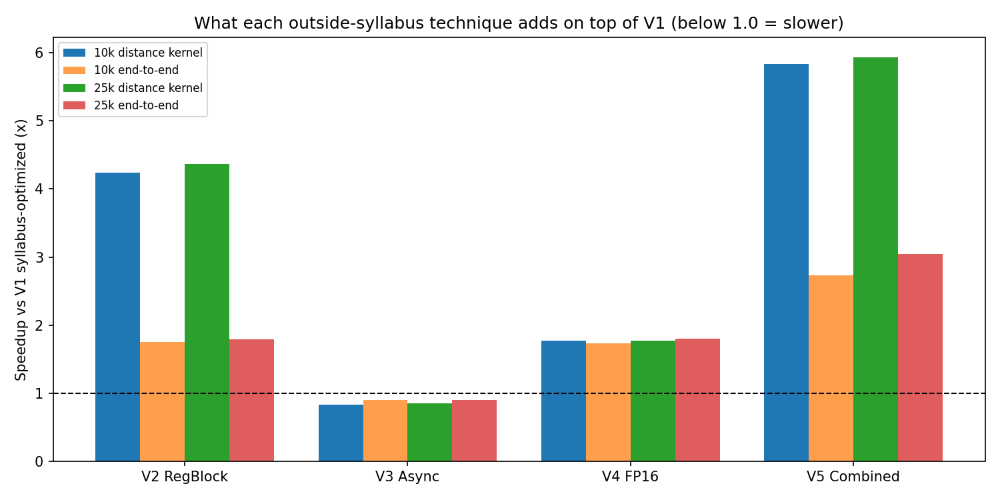
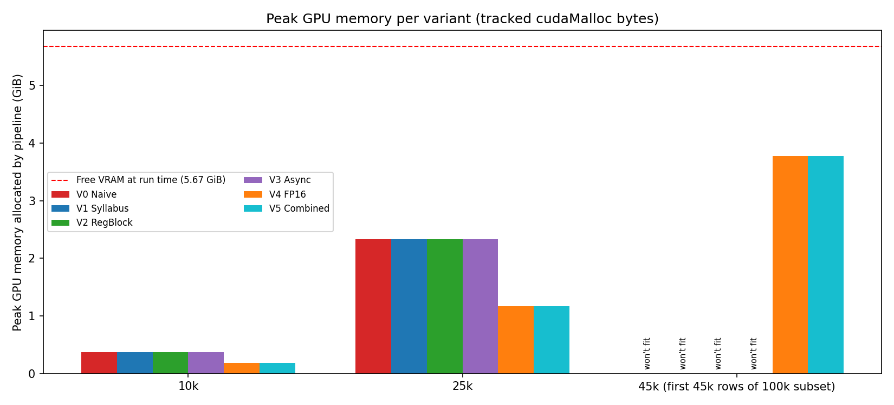
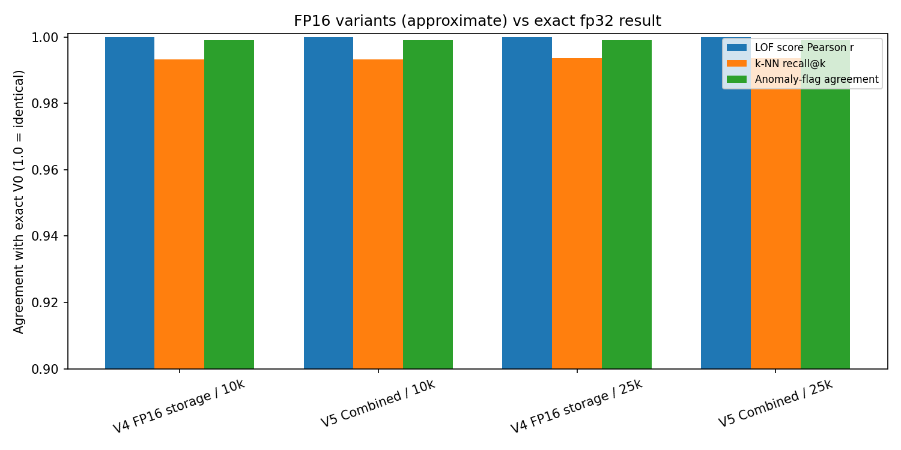

# CUDA-Optimized Local Outlier Factor for Large-Scale Cybersecurity Anomaly Detection

A research project that implements, validates, and benchmarks the **Local Outlier Factor (LOF)** unsupervised anomaly-detection algorithm twice — once as a transparent CPU reference in NumPy, once as a native CUDA C++ pipeline — and measures the GPU speedup on a real cybersecurity intrusion-detection dataset (**CICIDS2017**).

### Results at a glance

All numbers below come from one benchmark session (M8) on an NVIDIA RTX 4050 Laptop GPU (6 GB), 25,000 rows × 68 features, k = 20. Times are medians. The data is a synthetic CICIDS2017-shaped placeholder (see §3), which affects the anomaly results but not the timings.

| Step | What changed | Median time | vs. CPU | vs. previous step |
| :--- | :--- | ---: | ---: | ---: |
| CPU (NumPy) | Reference implementation | 21,504 ms | 1× | – |
| Naive GPU (V0) | One CUDA thread per distance | 294 ms | 73× | 73× |
| Syllabus-optimized GPU (V1) | Coalescing, shared-memory tiling, occupancy tuning, unrolling (course Modules 2–4) | 268 ms | 80× | 1.10× |
| + Register blocking (V2) | Each thread computes a 4×4 block of distances | 150 ms | 144× | 1.79× vs. V1 |
| + Async copy & double buffering (V3) | Loads the next tile while computing the current one | 300 ms | 72× | **0.90× vs. V1 (slower)** |
| + FP16 storage (V4) | 16-bit storage, 32-bit arithmetic — approximate | 149 ms | 145× | 1.80× vs. V1 |
| **All three combined (V5)** | V2 + V3 + V4 — approximate | **88 ms** | **244×** | **3.04× vs. V1** |

V2, V3 and V4 are each applied to V1 on their own, so each "vs. V1" figure is that one technique's contribution. FP16 also halves GPU memory, which lets V4/V5 run 45,000 rows where every 32-bit version runs out of VRAM. Full tables, accuracy and per-kernel detail are in [§16](#16-advanced-optimizations-beyond-the-syllabus-m8--measured-same-hardware); the dashboard's **Optimization Journey** page shows the same data interactively.



---

## 1. Why this project exists

Network intrusion detection increasingly relies on **unsupervised** anomaly detection because labeled attack data is scarce and attackers constantly invent new patterns (zero-days). LOF is attractive for this because it flags a point as anomalous purely by comparing the *local density* around it to the density around its neighbors — no attack labels required.

The catch: LOF's two core stages — the **all-pairs distance matrix** and the **k-nearest-neighbor search** — are $O(N^2 \cdot D)$ and $O(N^2)$ respectively. The CPU baseline measured in this repo spends **>99.8% of its runtime** in exactly those two stages (see §6), and naive CPU LOF would take an estimated **thousands of hours** to run on the full 2.52M-row CICIDS2017 dataset. That quadratic wall is why this project exists: to show, with real measurements, how much of that wall GPU parallelism removes, and where the GPU's own new bottlenecks appear.

**Why CUDA specifically:** both bottleneck stages are embarrassingly parallel — each `(i, j)` distance and each per-row top-k search is independent — which maps cleanly onto thousands of CUDA threads, and network flow features are naturally stored as dense float32 matrices that transfer and compute efficiently on a GPU.

---

## 2. What is actually implemented vs. what is projected

To be precise about the state of the repository:

| Milestone | Status | What it actually is |
| :--- | :--- | :--- |
| **M1** Dataset prep | ✅ Real | Preparation pipeline is real code, cleaning/scaling/splitting into real `.npz` subsets — **but see §3 below: on this machine it ran on a synthetic placeholder, not downloaded CICIDS2017** |
| **M2** CPU LOF baseline | ✅ Real | First-principles NumPy LOF, validated against scikit-learn, timed on real hardware |
| **M3** CUDA LOF baseline | ✅ Real | Native CUDA C++ kernels compiled with `nvcc`, executed on a physical GPU, timed with CUDA events, cross-checked against the CPU baseline |
| **M4** Profiling | ✅ Real (CUDA-event) / ⚠️ Nsight counters blocked | Real per-kernel timing via `CudaLofTimings` on an actual CUDA build. Nsight Compute and Nsight Systems are installed, but Windows blocks access to the GPU's performance counters without admin permission (`ERR_NVGPUCTRPERM`), so hardware counters (achieved occupancy, throughput) are not collected. Registers, shared memory and theoretical occupancy per kernel are collected another way in M8 (§16) |
| **M5** Optimization | ✅ Real | A shared-memory-tiled distance kernel and a tuned k-NN kernel were implemented, built, and measured against the naive baseline on real hardware — modest, honestly-reported speedup (see §12) |
| **M6** Final benchmarks | ✅ Real (10K–25K) / 🚫 Infeasible (100K–1M) | Real CPU vs. naive-CUDA vs. optimized-CUDA measurements at 10K/25K. 100K+ sizes were checked against live VRAM/RAM and correctly refused, not faked — see §13 |
| **M7** Dashboard & final docs | ✅ Done | This README plus a Streamlit dashboard (`app.py`) that reads every result below live from disk |
| **M8** Advanced optimizations | ✅ Real | Three GPU optimization techniques from outside the course syllabus (register blocking, async double-buffered copies, FP16 storage) plus all three combined, measured against CPU, naive GPU and syllabus-optimized GPU in **one benchmark session** — see §16 |

This repo was originally built with M4–M6 as **analytical projections only** (`src/python/benchmarking/milestones.py`, which scales M2's CPU numbers by hardcoded speedup multipliers) because no working CUDA toolchain was available in that environment. That module is left intact as a historical artifact — the dashboard's benchmark page shows it labeled "projected" next to the real M4–M6 numbers below, so the two are never conflated. Every number under `results/m4_profiling/`, `results/m5_cuda_optimized/`, and `results/m6_final_benchmarks/` as of this revision is a **real CUDA-event measurement** on an NVIDIA RTX 4050 Laptop GPU (sm_89, CUDA 13.5) — a different machine than the original RTX 3050 (sm_86) that produced the M3 numbers in §7. The two GPUs are never merged into one comparison; where both appear, the hardware is labeled.

---

## 3. Dataset: CICIDS2017

> ⚠️ **On this machine, the data is a synthetic placeholder, not real CICIDS2017.** `data/raw/` is empty here — no CICIDS2017 CSVs were ever downloaded on this machine — and `data/processed/dataset_metadata.json` records its own source file as `synthetic_cicids2017.csv` with a 3-class label scheme (`BENIGN`/`DDoS`/`PortScan`) instead of the real dataset's 15 classes. The rows/features/scaling match CICIDS2017's shape (1M rows, 68 numeric features, z-scored) so that pipeline code, kernel timings, and memory-scaling conclusions in §6–§13 are still meaningful — runtime and VRAM depend on row/feature count, not on label semantics — but any *anomaly-detection result* (which specific points get flagged, attack-type breakdowns) is **not a validated real-world finding** on this machine. The table below describes the real CICIDS2017 cleaning pipeline as designed and as it ran against actual CIC data on the original development machine; treat it as the pipeline's specification, not this machine's live numbers.

Source: Canadian Institute for Cybersecurity (CIC), University of New Brunswick — [ids-2017.html](https://www.unb.ca/cic/datasets/ids-2017.html). 5 days of labelled network flow captures (`GeneratedLabelledFlows.zip`), processed with CICFlowMeter into 8 CSVs.

| Stage | Rows | Notes |
| :--- | :---: | :--- |
| Raw (8 CSVs concatenated) | 2,830,743 | 79 columns |
| After removing NaN/±Inf rows | −2,867 | `Flow Bytes/s`, `Flow Packets/s` corruption |
| After deduplication | −308,381 | prevents zero-distance collapse in k-NN |
| **Clean dataset** | **2,520,798** | 89.05% retention |

- **Features**: 68 of 79 columns kept (numeric only). Excluded: `Label` (target, leakage), `Destination Port` (categorical, not Euclidean), `Fwd Header Length.1` (duplicate column — CICFlowMeter bug), and 8 zero-variance flag/bulk-rate columns.
- **Labels**: decoupled into `y_raw` (attack name string), `y_multiclass` (15 classes, 0=BENIGN), `y_binary` (0=benign, 1=anomaly).
- **Class balance**: 83.11% BENIGN, 16.89% attack traffic across 14 attack types (DoS Hulk, DDoS, PortScan, DoS GoldenEye, FTP/SSH-Patator, Bot, Web Attacks, Infiltration, Heartbleed — down to only 11 Heartbleed samples). This long-tailed imbalance is exactly why an *unsupervised* density method like LOF is a reasonable fit: supervised classifiers starve on the rare classes.
- **Scaling**: z-score standardization (`StandardScaler`), cast to `float32` (half the memory of `float64`, and the native throughput format for consumer GPUs).
- **Reproducible stratified subsets** (fixed seed 42): 10K, 25K, 100K, 250K, 500K, 1M, and the full 2.52M set — sized specifically so the smaller ones fit a dense $N\times N$ distance matrix inside the RTX 3050's 6GB VRAM, while the larger ones intentionally don't (used only for projected/extrapolated numbers, not naive dense GPU runs).

---

## 4. The algorithm: Local Outlier Factor (Breunig et al., 2000)

Both implementations (CPU and GPU) compute the exact same five stages, with the exact same formulas, so their outputs are numerically comparable.

1. **Pairwise Euclidean distance**
   $$d(p,q) = \sqrt{\textstyle\sum_{f=1}^{D} (p_f - q_f)^2}$$
2. **k-distance and k-NN set** — sort each row, take the nearest $k$ neighbors (excluding self); $k\text{-distance}(p)$ is the distance to the $k$-th nearest.
3. **Reachability distance** — dampens distance fluctuations inside dense clusters while preserving true distances for outliers:
   $$\text{reach-dist}_k(p,o) = \max(k\text{-distance}(o),\, d(p,o))$$
4. **Local Reachability Density (LRD)** — inverse of the mean reachability distance to the $k$ neighbors:
   $$\text{lrd}_k(p) = \frac{1}{\frac{1}{k}\sum_{o \in N_k(p)} \text{reach-dist}_k(p,o) + \epsilon}$$
5. **LOF score** — ratio of a point's neighbors' average density to its own:
   $$\text{LOF}_k(p) = \frac{\frac{1}{k}\sum_{o \in N_k(p)} \text{lrd}_k(o)}{\text{lrd}_k(p) + \epsilon}$$

   - $\text{LOF} \approx 1$ → point sits in a cluster of similar density (normal traffic).
   - $\text{LOF} \gg 1$ → point sits in a sparser region than its neighbors (anomalous traffic / potential attack).

   Anomaly decision: threshold at the $(1-c)$-percentile of LOF scores, where contamination $c$ defaults to 0.10 (flag the top 10% as attacks).

Default parameters throughout the project: $k = 20$ neighbors, $\epsilon = 10^{-10}$, contamination $c = 0.10$.

---

## 5. Two implementations, same math

### CPU reference — `src/python/cpu/cpu_lof.py` (`CPULocalOutlierFactor`)
Vectorized NumPy. Distance is computed via the quadratic expansion $\|p-q\|^2 = \|p\|^2 + \|q\|^2 - 2\langle p,q\rangle$ (a single `X @ X.T` matmul) — fast, but for near-duplicate rows in float32 this subtracts two large, nearly equal numbers and can round to exactly `0.0` (catastrophic cancellation). This is a known, documented discrepancy source (§7). `np.argsort` finds the k-NN. Every stage is individually timed.

### CUDA pipeline — `src/cuda/` (native C++/CUDA, called from Python via `ctypes`)
Direct coordinate-difference accumulation $\sum(p_d-q_d)^2$ instead of the matrix-expansion trick — this avoids the cancellation bug and is actually *more* numerically accurate than the CPU reference, not just faster (verified in §7). Five kernels, one orchestrator:

```
Host X (N, 68) float32
   │  cudaMemcpy H2D
   ▼
pairwise_distance_naive_kernel   dim3(16,16) 2D blocks  →  d_dist (N, N)
   │  (d_X freed immediately after this stage)
   ▼
knn_naive_kernel                 256 threads/block, 1D   →  d_knn_indices (N,k), d_knn_distances (N,k)
   │  (d_dist — the large N×N matrix — freed immediately: this is the key VRAM trick)
   ▼
reachability_distance_naive_kernel                        →  d_reach_dists (N,k)
   │  (d_knn_distances freed)
   ▼
lrd_naive_kernel                                           →  d_lrd (N,)
   │  (d_reach_dists freed)
   ▼
lof_scoring_naive_kernel                                   →  d_lof_scores (N,)
   │  cudaMemcpy D2H
   ▼
Host LOF scores (N,) float32
```

| Kernel | File | Role | Launch config |
| :--- | :--- | :--- | :--- |
| `pairwise_distance_naive_kernel` | `src/cuda/kernels/distance_kernel.cu` | $d(i,j)=\sqrt{\sum_d(X_{i,d}-X_{j,d})^2}$, diagonal forced to 0 | 2D grid, `dim3(16,16)` blocks |
| `knn_naive_kernel` | `src/cuda/kernels/knn_kernel.cu` | per-row scan + register-local insertion sort to keep the k smallest distances, self excluded | 1D grid, 256 threads/block |
| `reachability_distance_naive_kernel` | `src/cuda/kernels/reachability_kernel.cu` | $\max(k\text{-distance}(o), d(p,o))$ over all $N\times k$ (point, neighbor) pairs | grid-stride |
| `lrd_naive_kernel` | `src/cuda/kernels/lrd_kernel.cu` | mean reachability distance, inverted with $\epsilon$ guard | 1D over $N$ |
| `lof_scoring_naive_kernel` | `src/cuda/kernels/lof_kernel.cu` | neighbor LRD average ÷ own LRD | 1D over $N$ |

Orchestration lives in `src/cuda/lof/cuda_lof_pipeline.cu` (`compute_lof_pipeline_cuda` / `_cuda_timed`), which is the piece that actually frees each intermediate GPU buffer as soon as it's consumed — this is what keeps VRAM usage from exploding: the $N\times N$ distance matrix ($2.5\text{GB}$ at $N=25\text{K}$) is deallocated right after k-NN extraction, so stages 3–5 run with under 5MB resident. `src/cuda/common/cuda_utils.cuh` holds error-check macros and device-query helpers; `src/cuda/common/smoke_test.cu` is a standalone vector-add sanity check for the toolchain, independent of LOF.

Python never calls `nvcc` directly — compiled `.dll`s (`bin/distance_kernel.dll`, `bin/knn_kernel.dll`, `bin/cuda_lof.dll`) are loaded via `ctypes.CDLL` and called with raw pointers from `src/python/cuda/{distance,knn,lof}.py`.

---

## 6. CPU baseline results (M2 — measured)

Hardware: 13th-gen Intel Core i5-13450HX (10C/16T), 16GB RAM, Windows 11, Python 3.13.11, NumPy 2.4.4.

| Stage | 10K | 25K | Share of total (25K) |
| :--- | :---: | :---: | :---: |
| Pairwise distance | 1.39s | 10.98s | 49.59% |
| k-NN search & sort | 1.67s | 11.13s | 50.26% |
| Reachability + LRD + LOF scoring | ~0.006s | ~0.03s | 0.15% |
| **Total LOF compute** | **3.06s** | **22.14s** | **100%** |

A $2.5\times$ increase in $N$ (10K→25K) produced a $\sim$7.2× runtime increase — consistent with the theoretical $O(N^2)$ scaling ($2.5^2=6.25$). Extrapolated to the full 2.52M-row dataset, naive CPU LOF would take on the order of **thousands of hours**. This single number is the project's entire motivation for parallelizing on a GPU.

---

## 7. CUDA baseline results (M3 — measured on NVIDIA RTX 3050 6GB, sm_86)

| Metric | 10K | 25K |
| :--- | :---: | :---: |
| CPU end-to-end (M2) | 3.08s | 19.70s |
| CUDA end-to-end | **0.080s** | **0.567s** |
| **End-to-end speedup** | **38.6×** | **34.7×** |
| Kernel-only speedup | 47.3× | 39.8× |
| H2D / D2H transfer | <1ms combined | <1ms combined (<1.5% of pipeline) |
| Distance kernel share | 66.3% | 48.0% |
| k-NN kernel share | 33.6% | 51.9% |
| Correctness vs. CPU (Pearson r) | 0.9999982 | 0.26 raw / **0.9999999** on a same-distance diagnostic* |
| Anomaly agreement | 99.98% | 99.58% (99.99% on the diagnostic) |

\* **Why 25K correlation looks bad at first glance**: it isn't a GPU bug. The CPU reference's matrix-expansion distance formula hits float32 catastrophic cancellation on ~110 near-duplicate points in the 25K subset, driving a handful of CPU LRD/LOF values to spurious $\sim10^9$-scale outliers. The CUDA kernel's direct-accumulation formula doesn't have this failure mode. Feeding the CUDA-computed distances back into the CPU LOF stages ("same-distance diagnostic") recovers $r=0.9999999$ agreement — proof the discrepancy is a known CPU-side float32 precision artifact, not a GPU correctness issue.

Dense 100K+ subsets are *excluded* from this naive baseline on purpose: $100\text{K}\times100\text{K}\times4\text{B}=40\text{GB}$, which exceeds the RTX 3050's 6GB VRAM. §13 shows this same wall measured again on the current (RTX 4050) machine, still unresolved — M5's tiling (§12) improved cache reuse, not VRAM capacity.

---

## 8. Build & run

### Toolchain — hardware-independent by design
Build scripts no longer hardcode a GPU architecture. Each `scripts\build_*.bat` reads an `ARCH` environment variable (default `sm_86`, the original RTX 3050) — override it for your own GPU's compute capability before building:

```cmd
call "<VS install path>\VC\Auxiliary\Build\vcvars64.bat"
set "PATH=<CUDA Toolkit install>\bin;%PATH%"
set "ARCH=sm_89"                REM e.g. sm_86=RTX 3050, sm_89=RTX 4050, sm_90=H100 — match your GPU
scripts\build_cuda_lof.bat run   REM naive kernels → bin\cuda_lof.dll
scripts\build_cuda_lof_optimized.bat run   REM M5 optimized kernels → bin\cuda_lof_optimized.dll
scripts\build_cuda_lof_variants.bat        REM M8 variants V0–V5 → bin\cuda_lof_variants.dll
```
Or run the equivalent `nvcc -arch=%ARCH% -O2 --shared -o bin\cuda_lof.dll <sources>` directly. M3's original build used CUDA Toolkit 12.8 + MSVC v143 targeting `sm_86`; M4–M7 on this machine used CUDA Toolkit 13.5 + VS2022 MSVC targeting `sm_89` — both work unmodified because of the `ARCH` parameterization. `src/python/environment/hardware_info.py` detects the running machine's actual CPU/GPU/driver/toolchain at runtime rather than assuming either.

### Data pipeline
```powershell
python preprocessing/inspect_dataset.py
python preprocessing/prepare_dataset.py --seed 42 --raw-dir data/raw --output-dir data/processed
```

### Experiments
```powershell
python scripts/run_cpu_baseline.py --subset 10k --k 20 --output-dir results/m2_cpu_baseline/benchmarks
python scripts/run_cuda_baseline.py --subset 10k --k 20
python scripts/run_benchmarks.py            # generates the OLD M4/M5/M6 *projected* reports (historical)
python scripts/run_m4_profiling.py          # real per-kernel CUDA profiling (needs a built bin\cuda_lof.dll)
python scripts/run_m5_optimization.py       # builds/measures the optimized kernels vs. naive
                                             # (M6 final benchmarks were produced by a one-off run combining
                                             #  run_cpu_baseline.py + run_cuda_baseline.py + lof_optimized.py
                                             #  across subsets, gated by a live VRAM/RAM feasibility check)
python scripts/run_m8_advanced_optimizations.py  # one same-session run: CPU + V0–V5 at 10k/25k, V4/V5 at 45k
python scripts/update_readme_tables.py           # rewrite the §16 table from the M8 results CSV
```

### Dashboard
```powershell
streamlit run app.py
```
Reads every artifact under `results/`, `data/`, and live hardware detection directly from disk — no hardcoded numbers. Pages degrade to an explicit "Not available" state if a result file is missing rather than crashing.

### Tests
```powershell
pytest -v tests/
```
Covers dataset integrity (`tests/test_dataset.py`), CPU LOF correctness against scikit-learn (`tests/test_cpu_lof.py`), CUDA smoke/distance/k-NN/naive-pipeline/optimized-pipeline kernels against the CPU reference, the M8 variants V0–V5 (`tests/cuda/test_cuda_lof_variants.py`: exact variants bit-identical to naive, FP16 variants within a documented tolerance, odd shapes, self-exclusion), and the Optimization Journey page's data preparation (`tests/test_dashboard_m8.py`). **All tests pass** once `bin/cuda_lof.dll`, `bin/cuda_lof_optimized.dll` and `bin/cuda_lof_variants.dll` are built (103 CUDA/CPU tests plus the dashboard tests on this machine); CUDA tests skip gracefully if a DLL is missing, e.g. on a CPU-only machine.

---

## 9. Repository layout

```
cuda-lof-cybersecurity/
├── app.py                     # Streamlit dashboard entry point (M7)
├── preprocessing/            # CICIDS2017 download/inspect/clean/scale → data/processed/
├── src/
│   ├── python/
│   │   ├── data/              dataset.py — loaders for the full dataset & fixed subsets
│   │   ├── cpu/                cpu_lof.py — first-principles NumPy LOF reference
│   │   ├── cuda/                distance.py / knn.py / lof.py — naive ctypes bindings;
│   │   │                        lof_optimized.py — M5 optimized-kernel ctypes bindings;
│   │   │                        lof_variants.py — M8 variants V0–V5
│   │   ├── benchmarking/        milestones.py — OLD M4/M5/M6 analytical projection generators (historical)
│   │   ├── environment/         hardware_info.py — dynamic CPU/GPU/OS/toolchain detection (M4)
│   │   ├── profiling/           capability_report.py — profiling-tool availability report (M4)
│   │   ├── dashboard/           Streamlit page modules + data loaders (M7); Optimization Journey page (M8)
│   │   └── visualization/     m1_/m2_/m3_/m5_visualizations.py — chart generation from real result JSON/CSV
│   └── cuda/
│       ├── common/             cuda_utils.cuh (error macros, device info), smoke_test.cu (toolchain check)
│       ├── kernels/             NAIVE: distance_, knn_, reachability_, lrd_, lof_kernel.cu/.cuh + test_*.cu
│       ├── kernels_optimized/   M5 OPTIMIZED: shared-memory-tiled distance_kernel_optimized.cu,
│       │                        tuned knn_kernel_optimized.cu (reachability/lrd/lof reused unmodified —
│       │                        M4 showed them <0.2% of runtime, not worth optimizing)
│       ├── kernels_variants/    M8: register-blocked, cp.async double-buffered and FP16 distance/k-NN kernels
│       └── lof/                 cuda_lof_pipeline.cu/.cuh (naive) + cuda_lof_pipeline_optimized.cu/.cuh (M5) +
│                                 cuda_lof_pipeline_variants.cu/.cuh (M8, V0–V5 with peak-memory tracking);
│                                 test_cuda_lof.cu
├── scripts/                   build_*.bat (ARCH-parameterized nvcc build scripts, naive + optimized),
│                               run_cpu_baseline.py, run_cuda_baseline.py, run_benchmarks.py (old projections),
│                               run_m4_profiling.py (real profiling), run_m5_optimization.py (real optimization),
│                               run_m8_advanced_optimizations.py (same-session CPU + V0–V5 run),
│                               update_readme_tables.py (regenerates the §16 table), generate_m3_charts.py
├── tests/                     pytest suite — CPU, dataset, naive CUDA, and optimized CUDA kernel correctness
├── data/{raw,processed}/      raw CICIDS2017 CSVs → cleaned .npz full set + stratified subsets
│                               (⚠️ on this machine: synthetic placeholder, see §3)
├── results/m{1..6}_*/, m8_*/  tables/, charts/, benchmarks/ per milestone — m1–m8 are ALL real measurements
│                               on this machine (see §2); the old milestones.py projections remain viewable
│                               separately in the dashboard for comparison
└── docs/                      PROJECT_PLAN.md, WINDOWS_SETUP_GUIDE.md, one report per milestone (M1_*.md … M8_*.md)
```

---

## 11. CUDA profiling (M4 — measured on NVIDIA RTX 4050 Laptop 6GB, sm_89, CUDA 13.5)

Per-kernel CUDA-event timing (2 warm-up + 10 timed runs each), via the pipeline's existing `CudaLofTimings` instrumentation — the hooks were always there, this is the first time they were exercised on a machine with a working `nvcc`:

| Kernel | 10K | Share | 25K | Share |
| :--- | :---: | :---: | :---: | :---: |
| Pairwise distance | 28.62ms | **78.9%** | 169.82ms | **80.0%** |
| k-NN | 7.57ms | 20.9% | 42.30ms | 19.9% |
| Reachability | 0.03ms | 0.08% | 0.07ms | 0.03% |
| LRD | 0.03ms | 0.09% | 0.01ms | <0.01% |
| LOF scoring | 0.02ms | 0.06% | 0.03ms | 0.02% |

**Confirmed bottleneck: the pairwise-distance kernel, ~80% of kernel time at both sizes** — this is what M5's optimization targets. Nsight Compute/Systems were not installed on this machine (not bundled with the CUDA 13.5 installer), so occupancy, register pressure, and memory-throughput metrics were not collected — only wall-clock CUDA-event timing. Full data: `results/m4_profiling/{kernel_timing,transfer_timing}.csv`, `bottleneck_analysis.md`.

---

## 12. CUDA optimization (M5 — measured, same hardware)

A shared-memory-tiled pairwise-distance kernel and a tuned k-NN kernel were built in `src/cuda/kernels_optimized/`, kept entirely separate from the naive kernels so both remain independently buildable and comparable.

| Stage | 10K naive → optimized | Speedup | 25K naive → optimized | Speedup |
| :--- | :---: | :---: | :---: | :---: |
| Distance kernel | 27.55 → 23.72ms | 1.16× | 169.38 → 149.17ms | 1.14× |
| k-NN kernel | 7.59 → 7.02ms | 1.08× | 42.29 → 41.45ms | 1.02× |
| **End-to-end** | 52.26 → 43.63ms | **1.20×** | 278.26 → 264.99ms | **1.05×** |

**The honest story is a modest win, not a dramatic one.** A first attempt at 32×32 shared-memory tiles was actually ~5× *slower* than naive — 1024 threads/block left only one resident block per SM on this GPU, collapsing occupancy. Dropping to 16×16 tiles fixed that. Even after the fix, the gain tops out around 14–16%, because this dataset's full feature matrix (2.7–6.8MB at 10K–25K rows × 68 features) fits entirely inside this GPU's 24MB L2 cache — the naive kernel's "redundant" global-memory reads were mostly L2 cache hits already, leaving less headroom for shared-memory tiling to reclaim than the textbook case assumes. This is a legitimate, reportable finding about *this* workload's cache behavior, not a failed optimization.

Correctness: naive vs. optimized CUDA are **bit-identical** (max abs. error 0.0, Pearson r = 1.00000000) at both sizes; both agree with a freshly-regenerated CPU baseline at r ≈ 0.99999997 with 100% anomaly-flag agreement. Reachability/LRD/LOF-scoring kernels were left unmodified — M4 showed them at <0.2% of total runtime combined, not worth the risk of touching. Full data: `results/m5_cuda_optimized/` (`optimization_report.md`, `kernel_comparison.csv`, `correctness_report.json`, 5 charts).

---

## 13. Final benchmarks & scalability (M6 — measured, same hardware)

| Subset | CPU | Naive CUDA | Optimized CUDA | Naive speedup | Optimized speedup |
| :--- | :---: | :---: | :---: | :---: | :---: |
| 10K | 3185ms | 48.3ms | 43.6ms | 65.9× | 73.1× |
| 25K | 24996ms | 279.0ms | 273.7ms | 89.6× | 91.3× |

> **Note on these numbers:** they come from the first M6 run. M6 was re-run on 2026-11-15 to restore its result files, and that re-run gave different timings (for example CPU at 10K: 5593 ms instead of 3185 ms), most likely because of laptop power and clock state and less free RAM. `results/m6_final_benchmarks/` now holds the re-run. Both are real measurements from separate sessions, so they shouldn't be compared step by step. **The canonical comparison is the M8 table in §16**, which measures CPU and every GPU version in one session.

**100K, 250K, 500K, and 1M were checked against live free VRAM/RAM and correctly refused, not run with fabricated numbers.** A dense $N\times N$ float32 distance matrix needs 37GB at 100K, scaling to 3.7TB at 1M — far beyond this GPU's 6GB VRAM and the host's available RAM at measurement time. Both the naive and M5-optimized kernels still materialize the full matrix at once (M5 only improved cache reuse *within* that allocation, it did not remove it), so this is a genuine architectural ceiling of the current kernel design, not a missing experiment. Reaching 100K+ (or the real 2.52M-row full dataset) needs an out-of-core/chunked distance-and-k-NN kernel that processes the matrix in VRAM-sized blocks and only ever keeps each row's running top-k — a well-scoped, currently unimplemented, future-work item. Full data and the memory-feasibility table: `results/m6_final_benchmarks/` (`scalability_analysis.md`, `memory_analysis.csv`, 7 charts, including one that visually separates these real measurements from the old `milestones.py` projections).

---

## 14. Dashboard (M7)

`app.py` (+ `src/python/dashboard/`) is a Streamlit app with pages for: Overview, Hardware & Environment (live detection vs. recorded historical hardware, kept separate), Dataset Analytics (with the §3 synthetic-data banner), CPU vs. GPU Benchmarks, **Optimization Journey** (M8 — CPU → naive GPU → syllabus-optimized → each outside-syllabus technique → combined, from one session), Benchmark Lab (run CPU, naive, syllabus-optimized or V2–V5 live), CUDA Profiling, CUDA Optimization, Memory & Scalability (including a live N→estimated-memory calculator), Anomaly Detection Results (with an unsupervised-flags-≠-ground-truth disclaimer), Correctness & Numerical Validation, Experiment History, and Exports. Every page reads directly from the files already described above — it does not recompute or fabricate anything; a missing result file renders an explicit "Not available" message instead of crashing.

```powershell
streamlit run app.py
```

---

## 15. Roadmap

| Milestone | Status |
| :--- | :--- |
| M0 Repo/env setup | Done |
| M1 Dataset preparation | Done (⚠️ synthetic placeholder data on this machine — see §3) |
| M2 CPU LOF baseline | Done |
| M3 CUDA LOF baseline | Done |
| M4 CUDA profiling | Done — real CUDA-event per-kernel timing; Nsight Compute/Systems unavailable on this machine |
| M5 CUDA optimization | Done — real shared-memory-tiled distance kernel + tuned k-NN, modest honestly-reported speedup |
| M6 Final benchmarking | Done at 10K–25K (real); 100K–1M correctly marked infeasible on this hardware, not faked |
| M7 Analysis & documentation + dashboard | Done |
| M8 Advanced optimizations (outside syllabus) | Done — register blocking, async double-buffered copies, FP16 storage and all combined, measured with CPU and V0/V1 in one session |

---

## 16. Advanced optimizations beyond the syllabus (M8 — measured, same hardware)

M8 asks one question: after the syllabus techniques (M5), how much does each technique from **outside** the course syllabus add on its own? To answer it fairly, every version is built into one library (`bin/cuda_lof_variants.dll`) and measured in **one benchmark session** with the same data, k = 20 and contamination = 0.10.

| Variant | What it is | Source |
| :--- | :--- | :--- |
| V0 Naive | One thread per distance, direct global-memory reads | GPU baseline |
| V1 Syllabus-optimized | M5 kernels: coalesced loads, 16×16 shared-memory tiling, occupancy tuning, loop unrolling, divergence removal, register-local top-k | Syllabus (Module 2 / 3 / 4) |
| V2 Register blocking | V1 + each thread computes a 4×4 block of distances, partial sums in registers | Outside syllabus |
| V3 Async copy + double buffering | V1 + `cp.async` loads the next tile into shared memory while the current one is computed | Outside syllabus |
| V4 FP16 storage | V1 + features and distance matrix stored as 16-bit floats, arithmetic in 32-bit | Outside syllabus — **approximate** |
| V5 Combined | Register blocking + async copies + FP16 storage | Outside syllabus — **approximate** |

Methodology: GPU timings are medians of 10 runs after 3 discarded warm-ups, taken in rotation across variants; CPU timings are medians of 5 runs after 1 warm-up. Peak GPU memory is now tracked inside the pipeline (running total of allocated bytes, cross-checked against `cudaMemGetInfo` within about 0.5%), replacing M6's after-the-fact `nvidia-smi` poll that reported 0 MB. The 45k size is the first 45,000 rows of the 100k subset; at that size only the FP16 variants fit in VRAM, which is checked live before any run.

<!-- M8_TABLE_START -->
**10k**

| Variant | Source | Exact / approx. | Median end-to-end | × vs CPU | × vs V0 | × vs V1 | Peak GPU memory |
| :--- | :--- | :---: | ---: | ---: | ---: | ---: | ---: |
| CPU (NumPy) | CPU reference | exact | 2,989.60 ms | 1.0× | 0.02× | 0.01× | – |
| V0 Naive | GPU baseline | exact | 48.55 ms | 61.6× | 1.00× | 0.92× | 384 MiB |
| V1 Syllabus-optimized | Syllabus | exact | 44.47 ms | 67.2× | 1.09× | 1.00× | 384 MiB |
| V2 Register blocking | Outside syllabus | exact | 25.46 ms | 117.4× | 1.91× | 1.75× | 384 MiB |
| V3 Async copy + double buffering | Outside syllabus | exact | 49.37 ms | 60.6× | 0.98× | 0.90× | 384 MiB |
| V4 FP16 storage | Outside syllabus | approximate | 25.68 ms | 116.4× | 1.89× | 1.73× | 192 MiB |
| V5 Combined | Outside syllabus (combined) | approximate | 16.27 ms | 183.8× | 2.98× | 2.73× | 192 MiB |

**25k**

| Variant | Source | Exact / approx. | Median end-to-end | × vs CPU | × vs V0 | × vs V1 | Peak GPU memory |
| :--- | :--- | :---: | ---: | ---: | ---: | ---: | ---: |
| CPU (NumPy) | CPU reference | exact | 21,504.27 ms | 1.0× | 0.01× | 0.01× | – |
| V0 Naive | GPU baseline | exact | 293.70 ms | 73.2× | 1.00× | 0.91× | 2,391 MiB |
| V1 Syllabus-optimized | Syllabus | exact | 268.18 ms | 80.2× | 1.10× | 1.00× | 2,391 MiB |
| V2 Register blocking | Outside syllabus | exact | 149.66 ms | 143.7× | 1.96× | 1.79× | 2,391 MiB |
| V3 Async copy + double buffering | Outside syllabus | exact | 299.52 ms | 71.8× | 0.98× | 0.90× | 2,391 MiB |
| V4 FP16 storage | Outside syllabus | approximate | 148.87 ms | 144.5× | 1.97× | 1.80× | 1,196 MiB |
| V5 Combined | Outside syllabus (combined) | approximate | 88.15 ms | 243.9× | 3.33× | 3.04× | 1,196 MiB |

**45k (first 45k rows of 100k subset)**

| Variant | Source | Exact / approx. | Median end-to-end | × vs CPU | × vs V0 | × vs V1 | Peak GPU memory |
| :--- | :--- | :---: | ---: | ---: | ---: | ---: | ---: |
| CPU (NumPy) | CPU reference | exact | not run — the CPU reference materialises at least one 45000x45000 float32 matrix (7.5 GiB) plus temporaries; 8.7 GiB RAM was available. O(N^2) extrapolation from the 25k median: ~70 s per run (ESTIMATED). | – | – | – | – |
| V0 Naive | GPU baseline | exact | not run — Needs ~7.56 GiB (+300 MiB margin) but only 5.67 GiB VRAM was free at run time | – | – | – | – |
| V1 Syllabus-optimized | Syllabus | exact | not run — Needs ~7.56 GiB (+300 MiB margin) but only 5.67 GiB VRAM was free at run time | – | – | – | – |
| V2 Register blocking | Outside syllabus | exact | not run — Needs ~7.56 GiB (+300 MiB margin) but only 5.67 GiB VRAM was free at run time | – | – | – | – |
| V3 Async copy + double buffering | Outside syllabus | exact | not run — Needs ~7.56 GiB (+300 MiB margin) but only 5.67 GiB VRAM was free at run time | – | – | – | – |
| V4 FP16 storage | Outside syllabus | approximate | 466.16 ms | – | – | – | 3,869 MiB |
| V5 Combined | Outside syllabus (combined) | approximate | 270.45 ms | – | – | – | 3,869 MiB |

_Generated by `scripts/update_readme_tables.py` from `results/m8_advanced_optimizations/variant_benchmarks.csv` — do not edit by hand._
<!-- M8_TABLE_END -->

**Findings in this run** (all detail in `results/m8_advanced_optimizations/` and `docs/M8_ADVANCED_OPTIMIZATIONS.md`):
- **Register blocking (V2) is the biggest single win:** its distance kernel is over 4× faster than V1's, and results stay bit-identical to the naive version.
- **Async double-buffered copies (V3) made things slower, by about 10%.** The copies are only 4 bytes each, the second shared-memory buffer lowers occupancy, and the feature matrix already sits in the 24 MB L2 cache, so there was almost no memory latency to hide. This is reported as measured, not hidden.
- **FP16 storage (V4) is about as fast as V2 and halves GPU memory.** That raises the largest dataset that fits on this 6 GB GPU from about 38k to about 54k rows. It is approximate: score correlation with the exact version is about 0.99989, the same neighbours are found about 99.3% of the time, and 99.9% of anomaly flags agree.
- **All three combined (V5) is the fastest**, roughly 3× faster than the syllabus-optimized version end-to-end, with the same accuracy as V4.
- **Nsight Compute could not be used.** Windows blocked access to the GPU's performance counters (`ERR_NVGPUCTRPERM`) and no admin settings were changed. Registers, shared memory and local-memory use per kernel come from `cudaFuncGetAttributes`; occupancy is the theoretical value from CUDA's occupancy calculator (labelled ESTIMATED).
- **Caveats:** only about 2.7 GiB of RAM was free during the CPU runs, so CPU times may be inflated by paging, and GPU timings at 25k vary a lot from run to run (medians are used). The k-NN kernels from M3/M5 still spill to local memory, a candidate for future work.

### Where each technique acts (per-kernel, 25k, median)

The three techniques target the distance kernel, which is about 80% of GPU time (§11). FP16 also speeds up the k-NN kernel, because k-NN reads the distance matrix and FP16 halves the bytes it has to read.

| Variant | Distance kernel | × vs V1 | k-NN kernel | × vs V1 |
| :--- | ---: | ---: | ---: | ---: |
| V0 Naive | 175.96 ms | 0.88× | 43.44 ms | 0.98× |
| V1 Syllabus-optimized | 154.17 ms | 1.00× | 42.69 ms | 1.00× |
| V2 Register blocking | 35.83 ms | **4.30×** | 42.71 ms | 1.00× |
| V3 Async copy + double buffering | 185.56 ms | 0.83× | 42.65 ms | 1.00× |
| V4 FP16 storage | 88.93 ms | 1.73× | 22.32 ms | **1.91×** |
| V5 Combined | 26.40 ms | **5.84×** | 22.36 ms | **1.91×** |

At 10k the picture is the same: distance kernel 4.24× (V2), 0.83× (V3), 1.77× (V4) and 5.83× (V5) vs. V1.

### Kernel resources (distance kernel)

Read from the compiled kernels with `cudaFuncGetAttributes` (measured); occupancy is the theoretical value from CUDA's occupancy calculator (estimated), because Nsight's hardware counters were blocked.

| Variant | Registers / thread | Shared memory / block | Theoretical occupancy |
| :--- | ---: | ---: | ---: |
| V0 Naive | 37 | 0 B | 100% |
| V1 Syllabus-optimized | 40 | 2,048 B | 100% |
| V2 Register blocking | 54 | 8,704 B | 66.7% |
| V3 Async copy + double buffering | 42 | 4,096 B | 83.3% |
| V4 FP16 storage | 34 | 1,024 B | 100% |
| V5 Combined | 78 | 12,288 B | 50.0% |

Register blocking is the clearest example that higher occupancy is not the goal in itself: V2 runs a third fewer warps per SM than V1 but is over 4× faster, because each thread computes 16 distances and reuses every value it loads from shared memory 4 times. V3 pays for its second shared-memory buffer with lower occupancy and gets nothing back, since the data is already in L2 cache. All k-NN kernels use 40 registers; the naive one spills 2,048 B per thread to local memory and the M5/M8 ones 256 B.

### FP16 accuracy (V4 and V5 vs. exact V0)

| Size | Max score error | Mean score error | Pearson r | Same neighbours (recall@k) | Same anomaly flags |
| :--- | ---: | ---: | ---: | ---: | ---: |
| 10k | 0.0068 | 0.00025 | 0.999886 | 99.33% | 99.90% |
| 25k | 0.0102 | 0.00025 | 0.999885 | 99.36% | 99.90% |

V4 and V5 produce identical scores to each other at every size (they share the same FP16 rounding), and no FP16 overflow occurred. At 45k there is no 32-bit GPU reference to compare against, because none fits in VRAM. V1–V3 are bit-identical to V0 at every size.

### Charts

| | |
| :---: | :---: |
|  |  |
|  |  |

### Reproduce

```powershell
scripts\build_cuda_lof_variants.bat              # with ARCH set for your GPU, see §8
python scripts\run_m8_advanced_optimizations.py  # CPU + V0–V5, writes results/m8_advanced_optimizations/
python scripts\update_readme_tables.py           # regenerates the tables above from the new CSV
```

On a different GPU the absolute times will differ; the techniques and the comparison method stay the same.
